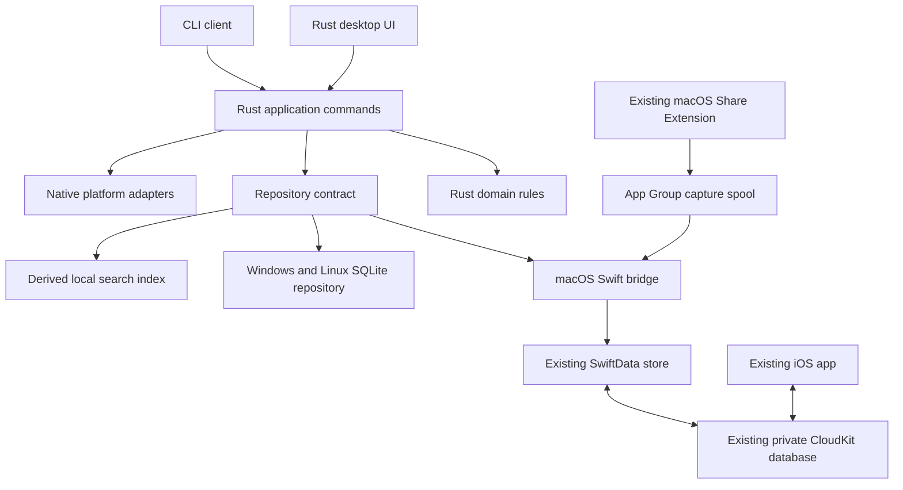

# Rust Cross-Platform Desktop Rewrite

## Goal

Replace the Swift macOS desktop UI with a Rust desktop app for Windows, macOS, and Linux. Keep the existing iCloud behavior on macOS. Store data locally on Windows and Linux. Do not implement synchronization for Windows or Linux.

This is an implementation plan, not an approved framework compatibility claim. Complete the feasibility gates before replacing the current macOS app.

## Execution Status

Implementation is incomplete. `Desktop/` contains portable domain rules, local capture and metadata persistence, filtered search, and an isolated `iced` feasibility sample. It does not contain a replacement desktop app. The current Swift application remains unchanged.

Phase 0 has a confirmed framework blocker: `iced` 0.14 lacks the required native accessibility integration. Production UI adoption is stopped. [ADR 0006](../decisions/0006-rust-desktop-feasibility-gates.md) records the evidence and required framework decision. Signed Apple integration evidence is also unavailable. Windows storage remains disabled because no supported directory durability protocol and private-ACL implementation have been established. Do not interpret headless tests or a sample build as completion of these gates. See [`Desktop/VERIFICATION.md`](../../Desktop/VERIFICATION.md) for the behavior inventory, verification results, and outstanding requirements. The completion checklist below remains unchanged.

## Scope

- Share the desktop UI, domain rules, search behavior, and application commands in Rust.
- Support links, text, code, images, and files.
- Preserve Library, quick panel, Quick Add, clipboard capture, search, filters, pinning, archive, Trash, restore, and settings.
- Preserve keyboard-first use, original clipboard formats where supported, and safe copy-only fallback.
- Preserve the macOS CLI contract and Share Extension capture path.
- Keep the Swift iOS/iPadOS app and its CloudKit schema unchanged.
- Retain native code where the operating system requires it. This is not a requirement to remove all Swift.

### Explicit exclusions

- Windows/Linux sync, iCloud access, sync settings, and cross-device duplicate reconciliation.
- A new sync service, account system, generic sync provider interface, or speculative conflict engine.
- An iOS rewrite, new CloudKit schema, or direct Rust access to SwiftData database files.
- A new updater service, plugin system, or simultaneous UI redesign.
- Guaranteed background clipboard capture or direct paste on every Linux desktop.

## Current System and Constraints

| Area | Current implementation | Rewrite consequence |
|---|---|---|
| Desktop UI | SwiftUI/AppKit in `Sources/StowApp/macOS/` | Replace views and coordination; preserve action semantics |
| Domain and persistence | SwiftData models and `StowRepository` in `Packages/StowCore/` | Separate portable rules from Apple persistence |
| iCloud | SwiftData/CloudKit; status observed by `CloudSyncMonitor` | Keep the existing store and signed Apple integration |
| Share capture | App Group staging and `CaptureSpool` | Preserve atomic publish, retry, and idempotent ingestion |
| Search | Derived SQLite index and `SearchCoordinator` | Port search rules; rebuild indexes instead of migrating index files |
| Clipboard | Native readers, representations, capture and paste policies | Use platform adapters, not a text-only clipboard abstraction |
| CLI | Host-owned mutation through automation spool | Keep one writer and preserve request replay behavior |

The existing cloud container is `iCloud.dev.narumi.stow`; the App Group is `group.dev.narumi.stow`. Keep identifiers, schema, entitlements, and production data ownership unchanged during the rewrite.

See [capture persistence](../decisions/0002-capture-persistence.md), [clipboard rules](../clipboard.md), [CLI contract](../cli.md), and [development checks](../development.md).

## Architecture Decision

### Desktop UI

Use `iced` as the initial Rust UI candidate. It permits shared Rust views and state without a JavaScript application layer. Confirm current framework and dependency behavior in Phase 0 before selecting versions.

Do not assume that a Rust UI framework supplies native quick-panel focus, tray integration, accessibility, or global shortcuts. Implement these through small platform adapters where necessary.

If `iced` cannot meet the accessibility or quick-panel gate, stop framework adoption and record an alternative decision. Tauri 2 is a possible fallback, but its web UI is not an all-Rust UI and requires explicit scope approval. Do not develop two UI implementations in parallel.

### Storage

Use one application-level repository contract with two implementations:

1. **macOS:** A narrow Rust-to-Swift bridge calls the existing SwiftData repository. SwiftData remains the only canonical store and continues to manage CloudKit.
2. **Windows/Linux:** A Rust repository uses SQLite and a private attachment directory. No sync engine is present.

Do not add a second canonical SQLite library on macOS. A derived search index is permitted, but must be disposable and rebuildable.



The diagram shows logical responsibilities, not a requirement for one crate per box.

### macOS Bridge Contract

- Prefer an in-process Swift library with a small C ABI. Validate the Swift runtime, linking, signing, and bundle layout first.
- Use versioned request/response data and explicit ownership for byte buffers. Do not expose Swift objects or Rust layouts across the ABI.
- Serialize SwiftData operations on the owning actor. Never block the desktop event loop while waiting for storage.
- Export item snapshots, attachments, representations, and operation results. Send invalidation events for local and cloud changes; refetch authoritative data after invalidation.
- Route mutations, spool ingestion, and legacy CLI requests through one application command boundary. Do not create competing capture consumers.
- Preserve capture IDs, mutation request IDs, response recovery, and duplicate-ingestion protection.
- Distinguish loading, local save success, cloud activity, paused sync, and unavailable storage. Local save success is not proof of cloud delivery.
- Continue to support the existing local-only macOS fallback when cloud access is unavailable. Do not silently switch an existing library to a new empty path.
- Never change the CloudKit schema to simplify the Rust implementation.

Keep existing Swift repository code where needed for compatibility. Rust owns portable decisions; the bridge owns Apple persistence and Apple API calls. Use shared fixtures to check behavior where Swift must retain equivalent rules for iOS.

## Proposed Source Layout

Add files only when their phase needs them:

```text
Desktop/
  Cargo.toml
  crates/
    stow-core/          # Domain types, validation, commands, repository contract
    stow-storage/       # Windows/Linux SQLite storage and attachment handling
    stow-platform/      # Platform adapters and macOS bridge client
    stow-desktop/       # UI, application state, and desktop entry point
    stow-cli/           # CLI client; preserve existing macOS contract
  native/macos/        # Swift bridge and native host integration
```

Keep the current `Sources/`, `Packages/`, and Xcode targets until replacement gates pass. Do not rename the existing Swift package as part of the initial setup.

## Data and Safety Rules

### Portable Model

Preserve item UUIDs, capture IDs, type, editable fields, source metadata, timestamps, use count, last capture time, fingerprint, pin state, lifecycle state, and restore state. Preserve attachment UUIDs, bytes, names, types, dimensions, thumbnails, and representation order.

- Use explicit serialization for enums, nullable values, and timestamps.
- Preserve original platform format identifiers with representation bytes. Map UTType, Windows formats, and MIME types in platform code.
- Do not claim that arbitrary native clipboard formats can be pasted on another platform.
- Port Unicode normalization, line-ending rules, ordering, and fingerprint inputs exactly. Compare Swift and Rust outputs with fixed fixtures before reuse of existing fingerprints.
- Preserve current duplicate rules: automatic clipboard capture can coalesce; Quick Add, share capture, and CLI add create new items. Matching Trash content creates a new Inbox item.

### Windows/Linux Storage

- Use `rusqlite` with a bundled SQLite build and FTS5, subject to Phase 0 license and build checks.
- Store the database and attachments under the user's platform application-data directory, not a temporary or installation directory.
- Apply numbered transactional schema migrations. Back up before destructive migrations and reject unsupported newer schemas.
- Enforce one library writer per user profile. A second process forwards commands or exits with a clear error.
- Stage attachments in the same filesystem, verify size and checksum, then publish them atomically. Commit database references only after durable blob publication.
- Recover interrupted staging and remove unreferenced blobs only after checking committed references. Test each interruption point.
- Use private directory permissions or ACLs, bounded reads, generated storage names, and symlink/path-traversal checks.
- Keep search indexing off the UI thread. Mark changed records for indexing durably; rebuild if the index becomes inconsistent.
- Do not add sync metadata, outboxes, remote IDs, or provider configuration.

### Content Handling

Carry forward the current payload limits: 1 MiB plain text, 5 MiB RTF/HTML each, 16 KiB URL, 100 MiB image or file, and 110 MiB total preserved representations per capture.

Check protected/transient markers before payload reads where platform conventions support them. Suppress Stow's own clipboard writes. Do not describe these checks as universal secret detection. Do not log content, attachment bytes, or full clipboard payloads.

Render HTML and link previews as untrusted content. Do not execute embedded scripts or launch attachments automatically. Keep metadata requests bounded by timeout, response size, allowed URL schemes, and redirect validation.

## Platform Capability Matrix

| Feature | macOS | Windows | Linux |
|---|---|---|---|
| Library, manual add, search, lifecycle | Required | Required | Required |
| Persistent storage | Existing SwiftData | Local SQLite | Local SQLite |
| Synchronization | Existing iCloud | Not included | Not included |
| Clipboard capture | Native pasteboard | Native clipboard notifications | X11 support; Wayland depends on compositor/protocol |
| Global shortcut | Native registration | Native registration | X11 or supported desktop portal |
| Quick panel | Native focus/activation integration | Native focus/activation integration | Compositor-dependent; normal window fallback |
| Direct paste | Optional, Accessibility permission | Best effort to validated target | X11 best effort; Wayland copy-only baseline |
| Tray/menu item | Required | Required | Use when available; normal window remains usable |
| Share Extension | Preserve existing extension | Not included | Not included |
| CLI | Preserve existing contract | Local client | Local client |

Clipboard writes and explicit user paste must work on supported Wayland environments. Background monitoring is not a release requirement where the compositor does not permit it. Show unsupported capabilities accurately; do not request broad privileges to bypass platform restrictions.

For direct paste, retain and validate the external target before panel activation. If focus changes unexpectedly, permission is missing, or the target cannot be validated, copy only. Never inject keystrokes into an unverified application or elevated Windows process.

Windows/Linux settings must state that the library is stored only on this device. Do not show iCloud sign-in, pending sync, or placeholder sync controls.

## Delivery Phases and Acceptance Gates

### Phase 0: Feasibility and Baseline

- Inventory current behavior and map relevant Swift tests to portable fixtures.
- Confirm minimum OS versions and release architectures. Start with macOS 14+, Windows 11 x64, and a named Linux x86_64 distribution; confirm exact Linux distribution and desktop versions before release.
- Build an `iced` sample on all three systems. Check keyboard navigation, IME, scaling, screen readers, high contrast, reduced motion, multiple monitors, and panel focus restoration.
- Build a signed macOS Rust host that loads the Swift bridge, opens the existing store, and exchanges changes with the unchanged iOS app through iCloud.
- Check App Group access, Share Extension packaging, CLI compatibility, and native dependencies.
- Record current search latency and memory use on fixed 10,000-item and 100,000-item datasets, with machine and build details.

**Gate:** Native builds pass; framework accessibility and panel requirements are demonstrated; signed iCloud and App Group operation are demonstrated. A local unsigned build is insufficient. Missing signing credentials block this gate, not Windows/Linux core development. Keep the old macOS app until it passes.

### Phase 1: Rust Domain and Local Repository

- Create the Cargo workspace, portable models, command results, and repository contract.
- Port validation, lifecycle transitions, ordering, duplicate rules, and capture normalization.
- Implement SQLite migrations, attachment publication, recovery, and derived search.
- Add deterministic clocks and fixture-driven repository tests without desktop access.

**Gate:** All portable fixtures pass on Windows, macOS, and Linux; restart and crash-injection tests preserve committed data and reject corrupt input.

### Phase 2: Shared Library UI

- Implement Library, details, Quick Add, editing, type/source/date filters, search, pin, archive, Trash, and restore.
- Add loading, empty, failed-save, unavailable-attachment, and search-recovery states.
- Keep unsaved edits after a failed save. Reject stale selection before actions.
- Implement settings from actual platform capabilities.

**Gate:** UI state and command tests pass without desktop automation. No synchronous storage or attachment loading blocks the UI thread. Use the Phase 0 datasets to compare search behavior and latency; agree on limits before accepting regressions.

### Phase 3: Native Desktop Integration

- Add clipboard capture and supported original-format restoration per platform.
- Add quick panel, shortcuts, tray/menu behavior, file drop, safe file export, and optional launch at login.
- Add target-validated direct paste only where supported; retain copy-only fallback.
- Add Rust CLI clients and local same-user command transport on Windows/Linux. Keep the macOS automation-spool protocol compatible.
- Test command authorization, timeout, request replay, clipboard race handling, and self-capture suppression.

**Gate:** Native adapter tests pass. Unsupported Wayland or desktop features are explicit and do not prevent manual capture or Library use.

### Phase 4: macOS Integration and Compatibility

- Complete the SwiftData bridge, cloud invalidation, search refresh, spool ingestion, and existing CLI routing.
- Package the current macOS Share Extension with the new host and preserve its capture contract.
- Test existing libraries through public SwiftData APIs, including external-storage blobs, original formats, trash state, and cloud-delivered changes.
- Prevent concurrent old/new desktop hosts from writing the same library during transition. Do not rely on a new lock that the old app does not understand; require the old host to exit before cutover.

**Gate:** Existing data opens without a schema change. Signed two-device checks cover create, edit, archive, restore, deletion, attachments, offline recovery, and account unavailability. Existing iOS behavior remains compatible.

### Phase 5: Packaging and Cutover

- Produce native release builds on each OS: macOS signed/notarized app bundle, Windows installer, and a Linux package validated on the named distribution.
- Preserve Apple bundle identity and entitlements where required. Do not publish two installable apps with the same identity as independent products.
- Document Windows runtime/GPU requirements and Linux display, graphics, portal, and tray dependencies found during Phase 0.
- Test clean installation, upgrade, launch, uninstall without data removal, and rollback.
- Back up local data with the app closed before cutover. Keep the old app and store format usable until release gates pass.
- Treat iCloud as live shared data: restoring a local backup does not undo already synced deletions. Rehearse recovery with test accounts, not production data.

**Gate:** All non-interactive checks pass, the final local verification batch passes on the declared support matrix, and signed macOS cloud checks pass. Retire the old desktop UI only after these gates; retain Swift persistence and iOS code.

## Verification Strategy

### Non-interactive Checks

- Run Rust formatting, Clippy with warnings denied, workspace unit tests, integration tests, and release builds in a native three-OS CI matrix.
- Check dependency licenses, security advisories, lockfile changes, and native build inputs.
- Continue relevant Swift package tests, native unit tests, macOS/iOS builds, project-generation checks, entitlement checks, and privacy-manifest checks.
- Test ABI buffer ownership, invalid requests, large payload bounds, bridge cancellation, and shutdown.
- Use fake platform adapters for focus transitions, denied permissions, clipboard changes, shortcut conflicts, and unavailable capabilities.
- Use isolated temporary libraries and fake cloud events. CI must never read a developer's clipboard, production library, or iCloud account.
- Keep CI free of interactive UI schemes and desktop automation.

### Final Local Verification Batch

Finish the complete implementation scope and relevant non-interactive checks before starting interactive UI tests. Keep all UI orchestration exclusively in `Scripts/ui_tests.sh`; extend that entry point for new desktop targets when needed. Do not add UI calls to CI scripts or workflows.

Accumulate scenarios for keyboard navigation, screen readers, IME, panel activation, focus restoration, original/plain-text paste, denied permissions, clipboard privacy markers, file drop, save recovery, scaling, and capability fallback. Include macOS Share Extension and unchanged iOS regression scenarios. Run the required scenarios together as one final verification batch. Diagnose all failures and group related fixes before rerunning.

Signed iCloud checks require a provisioned container and test devices. Record unavailable external prerequisites as blocked. Do not report cloud compatibility based on mocked events or unsigned builds.

## Main Risks and Stop Conditions

| Risk | Required control |
|---|---|
| Rust UI accessibility or panel behavior is insufficient | Stop UI adoption at Phase 0; approve an alternative before proceeding |
| Rust host cannot preserve signed CloudKit/App Group behavior | Keep current macOS host; do not replace iCloud with folder sync |
| Bridge and Rust rules diverge | Compare shared fixtures and use one command owner per operation |
| Cloud changes leave search stale | Invalidate and refetch authoritative snapshots; test index rebuild |
| Attachments are lost during migration or crashes | Avoid macOS store conversion; use durable publication and recovery tests elsewhere |
| Wayland prevents monitoring or synthetic paste | Declare the limitation and retain manual add, explicit paste, and copy-only use |
| Rewrite removes safe failure behavior | Port failure-path tests before deleting the corresponding Swift path |

## Completion Checklist

- [ ] Framework and signed macOS bridge feasibility gates pass.
- [ ] Rust desktop Library and quick panel meet the declared platform capability matrix.
- [ ] Windows/Linux data survives restart, upgrade, and interrupted writes without sync dependencies.
- [ ] macOS uses the existing canonical SwiftData store and iCloud container.
- [ ] iOS, macOS Share Extension, existing data, and macOS CLI remain compatible.
- [ ] No Windows/Linux sync implementation or speculative sync infrastructure is added.
- [ ] Non-interactive CI and the final local verification batch pass.
- [ ] Distribution, support limits, backup, and rollback instructions are complete.

Implement in the order above. Windows/Linux storage work can proceed after the repository contract is stable while signed macOS integration is blocked. Do not set a delivery date until Phase 0 confirms the UI and Apple integration risks.
