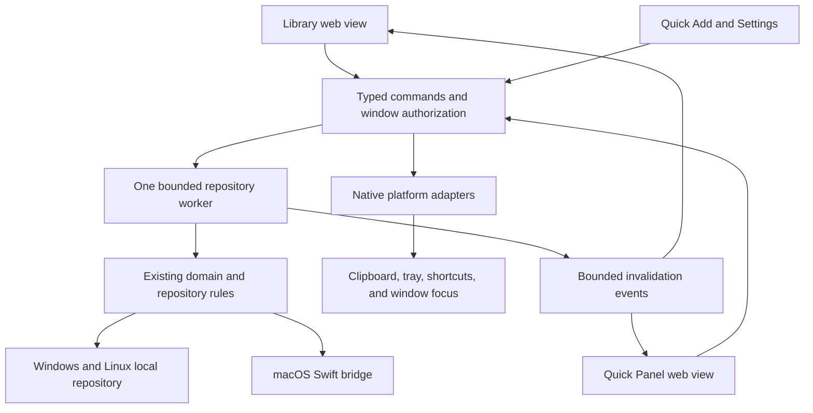

# Swift Desktop Parity for the Tauri App

## Goal and Status

Make the Tauri desktop app match the existing Swift macOS app in structure, content presentation, and interaction. Deliver a usable Windows app, not a styled storage-unavailable screen.

This document is a source-based study and an implementation plan. It does not implement or approve a replacement release. Research baseline: commit `ce512c4`, 2026-10-24.

Continue the [Rust desktop roadmap](2026-10-24_rust-cross-platform-desktop-plan.md) under [ADR 0006](../decisions/0006-rust-desktop-feasibility-gates.md). Tauri 2 with Rust and semantic HTML/CSS/JavaScript is already approved. No framework selection is needed. Matching the existing product is not a separate product redesign.

### Scope

- Match Library, Quick Add, Quick Panel, Settings, content actions, and recovery behavior.
- Start with Windows 11 x64. Keep the shared UI usable on macOS and Linux.
- Preserve native operating-system conventions. Do not copy macOS window buttons or Command-key labels onto Windows.
- Keep the Swift iOS app, Share Extensions, schema, App Group, and iCloud container unchanged.
- Keep Windows/Linux local-only. Do not add sync, accounts, an updater service, or a new frontend framework.
- Keep the Swift desktop app until the parent roadmap's replacement gates pass.

## Research Evidence

| Reference | What it establishes |
| --- | --- |
| [User's Windows preview](https://sharex.narumi.dev/2026/10/24/3KOUg9B4Tle60H39.png) | The current output is a form-oriented page with repeated unavailable-storage messages, exposed filters, and little content hierarchy. |
| [MacLibraryView.swift](../../Sources/StowApp/macOS/MacLibraryView.swift) | Three-column Library, adaptive filters, typed previews, multi-selection, contextual actions, editing, and Undo. |
| [MacLibraryPresentation.swift](../../Sources/StowApp/macOS/MacLibraryPresentation.swift) | Collection membership, counts, empty states, filter tokens, and applicable batch actions. |
| [MacVisualStyle.swift](../../Sources/StowApp/macOS/MacVisualStyle.swift) and [ItemPresentation.swift](../../Sources/StowApp/Shared/ItemPresentation.swift) | Semantic surfaces, spacing, type icons/colors, preview text, and basic code highlighting. |
| [RetrievalPanel.swift](../../Sources/StowApp/macOS/RetrievalPanel.swift) and [controller](../../Sources/StowApp/macOS/RetrievalPanelController.swift) | A separate horizontal retrieval surface, adaptive cards, keyboard handling, focus, and window lifecycle. |
| [QuickAddView.swift](../../Sources/StowApp/Shared/QuickAddView.swift) | Clipboard input, file/image drop, content editing, pin, and direct archive. |
| [MacSettingsView.swift](../../Sources/StowApp/macOS/MacSettingsView.swift) and [models](../../Sources/StowApp/macOS/MacSettingsModels.swift) | Grouped settings and transactional shortcut changes. |
| [User Guide](../user-guide.md) and [Clipboard Details](../clipboard.md) | Existing user workflows and clipboard behavior. |
| [Library/Settings screenshots](../release/v0.1-library-settings-visual-review.md) and [Quick Panel screenshots](../release/v0.1-quick-panel-visual-review.md) | Historical visual references and the states previously reviewed. |
| [Desktop README](../../Desktop/README.md) and [verification record](../../Desktop/VERIFICATION.md) | Current Rust capabilities, tests, missing integrations, and acceptance limits. |

The historical screenshots are from August. Current Swift code includes later visual changes. The [September polish record](2026-09-12_macos-visual-polish-plan.md) leaves its final visual batch blocked by Developer Mode. Do not label old screenshots as verified renders of current source.

The current Windows executable builds successfully with Rust 1.99.1 and embeds its frontend. It still disables storage. Existing 45 DOM tests and native CI establish build/state evidence, not Windows persistence or native UI parity. This planning task runs no desktop UI tests.

## What Must Match

### Library

- Use a three-column layout: navigation, collection, and detail.
  - Swift sidebar width: minimum 180, ideal 210, maximum 250 points.
  - Collection width: minimum 300, ideal 360, maximum 480 points.
  - Detail minimum: 340 points. Library minimum: 840×560; Swift default: 1120×740.
  - Treat these as logical layout references, not physical screenshot pixels. Record viewport, device scale, and OS scaling during final comparison.
- Sidebar groups: Library contains Inbox, Recently Used, and Pinned; Manage contains Archive and Trash.
  - Show counts from the complete library, independent of search and filters.
  - Pinned includes eligible archived items. Trash is excluded from Pinned and Recently Used.
  - Place Quick Add and accurate storage/privacy status at the bottom.
- Put search in the toolbar. Replace the exposed filter row with one adaptive Filter control.
  - Include type, known source applications, and date presets.
  - Show removable filter tokens, Clear, and search progress. Use a compact count when tokens do not fit.
- Rows contain a 40×40 thumbnail/type tile, two-line title and preview, pin state, source, and relative date.
- Detail separates the header, primary content actions, preview, metadata, and management actions.
  - Use typed link, text, code, image, and file presentations rather than one generic `pre` element.
  - Do not expose the edit form until Edit is chosen. Keep Cancel and Save Changes distinct.
- Support keyboard selection, range/toggle selection, applicable batch actions, context menus, and Trash Undo.
- Distinguish empty Inbox, empty collection, no search results, loading, failed search, and unavailable storage.
  - Give each state one clear explanation and a relevant action.
  - Do not show unsupported storage as an empty library or offer a retry for a permanent platform limitation.

### Visual System

- Map Swift semantic window/control surfaces to shared CSS tokens with light, dark, and high-contrast variants.
- Starting references: surface radius 14, surface padding 18, detail padding 24, detail content width at most 780 logical units.
- Preserve type identity: link blue, text teal, code purple, image pink, file orange. Color is not the only state cue.
- Use system fonts, licensed local icons, visible focus, restrained borders, and consistent control density.
- Do not redistribute SF Symbols as Windows assets. Do not add remote fonts, icons, or preview requests from the frontend.
- Keep a solid-surface fallback. Transparency is not required to complete a usable Library or copy-only panel.

### Quick Panel

This is a separate desktop surface, not a compressed Library or a large form.

- Place the panel at the bottom of the active display, with explicit multi-monitor and DPI handling.
- Swift references: outer margin 14, default height 340, minimum 210, maximum 60% of usable display height.
- Use a horizontal timeline. Card widths are 224 normally and 176 in compact mode; compact height begins below 275.
- Keep Search, Clipboard/Inbox/Pinned modes, paste capability, monitoring status, Quick Add, More, and Close available.
- Preserve type-specific cards, source fallback icons, pin/selection state, and keyboard hints.
- Typing starts search without losing the first character. Arrow keys navigate; Return uses; Space previews; explicit Copy keeps the panel open.
- Escape closes the inner layer before clearing search, collapsing Search, or closing the panel. Dirty edits require confirmation.
- Defer outside-click close while a menu or drag owns the interaction. Opening Library, Quick Add, or Settings must not stack conflicting panels.
- Ship copy-only behavior before direct paste. Show the actual capability, not a simulated success message.

### Quick Add and Settings

- Quick Add needs content input, explicit clipboard paste, code/language, file/image drop, attachment removal, title/note, pin, and direct archive.
- Retain stable capture IDs, replay conflict choices, and all draft data after failures or in-flight editing.
- Settings uses separate Capture, Paste & Shortcuts, Storage, and Privacy pages.
  - macOS retains Sync & Storage through its existing bridge. Windows/Linux do not show iCloud controls.
  - Controls report actual capabilities and provide real recovery actions.
  - Shortcut changes apply as one transaction. A rejected pair must not replace the previous working configuration.
  - Show search rebuild progress, success, and failure without destroying a usable prior index.

## Gap Analysis and Required Changes

| Area | Current Tauri preview | Required implementation |
| --- | --- | --- |
| Layout | Top buttons, exposed form filters, two content columns | Three-column shell, adaptive toolbar, deliberate empty/detail states |
| List data | ID/type/title/source/dates/status/pin summary | Bounded content preview and thumbnail references without full blobs or per-row detail requests |
| Collections | Status and pinned filters; no usage collection | Server-side collection membership, Recently Used ordering, and complete-library counts |
| Search | Explicit submission, exact-source input, UTC date range, 200 rows by default | Responsive search, source choices, Swift date presets, documented ordering, and bounded continuation |
| Selection | One item; Up/Down | Range/toggle selection, batch applicability, context menus, Trash Undo |
| Detail | Generic text plus attachment metadata | Typed previews, lazy verified thumbnails, copy/open/preview/export actions, separate editor |
| Windows persistence | Rejected before mutation | Approved and tested Windows durability/security protocol before enabling storage |
| Files and images | Repository can store bytes; UI creation/read/action path missing | Native bounded import, preview, materialization, export, and drag/drop |
| Native actions | No copy/open/monitor/tray/hotkey/panel adapter | Narrow native commands and capability-backed lifecycle |
| macOS data | No bridge; alternate SQLite store prohibited | Existing SwiftData repository through the signed Swift bridge |
| Distribution | Unsigned no-installer executable; bundling disabled | Runtime guidance first; signed distribution and upgrade/rollback gates later |

### Data Contracts Before View Work

Study [service DTOs](../../Desktop/crates/stow-desktop-service/src/dto.rs), [service commands](../../Desktop/crates/stow-desktop-service/src/lib.rs), and [storage search](../../Desktop/crates/stow-storage/src/search.rs).

- `ItemSummary` lacks row previews, thumbnail references, and usage fields. Do not fetch every detail to draw a list.
- Add bounded display data. Specify per-field and per-response limits before exposing more item content.
- Compute counts and collection filtering in Rust before the result limit. Never count or sort only the visible 200 rows and label that result complete.
- Add bounded continuation and stable tie-breaking. Define whether search rank or collection order takes precedence, then compare with Swift fixtures.
- Recently Used depends on `last_used_at`, not `created_at`. Domain usage rules exist; native use commands are not wired through the service.
  - Browsing detail must not record use. Match the successful explicit-use recording points in Swift.
- Swift date presets use the current calendar: Today, past seven days, and past calendar month.
  - Define timezone conversion explicitly; a calendar month is not always 30 days.
  - Preserve existing explicit UTC range semantics until a documented change replaces them. Retain inclusive nanosecond bounds and add DST/month-boundary fixtures.
- Expose revision-checked batch operations using existing repository rules. One conflict must not silently leave a partial batch.
  - Define select-all scope across pages. Never call a loaded-page selection the complete result set.
  - Implement the existing Trash Undo operation, not a generic undo framework. Reject stale Undo revisions.

## Architecture and Safety

Keep Rust responsible for persistence, content operations, and native adapters. Keep semantic HTML and local CSS/JavaScript responsible for presentation and transient view state.

This is the target responsibility map. The service currently owns a concrete local repository; the macOS bridge path is not implemented.

- Keep `Desktop/web/public/` as the embedded frontend. Do not bundle tests or development packages.
- Extend the existing application rather than add a second UI stack. Split view/state modules only when their responsibilities or tests justify it.
- Retain text-only rendering for captured markup. Code highlighting must create text nodes, not trust stored HTML.
- Keep list/search metadata separate from original attachment bytes. Decode and load previews lazily with size, dimension, time, and stale-selection limits.
- Resolve item/attachment UUIDs in Rust. Never accept arbitrary filesystem paths or shell commands from the web UI.
- Define a narrowly authorized thumbnail command or local resource contract before adding previews. Specify MIME types, CSP, bounds, cancellation, and deleted-ID behavior.
- Keep network metadata retrieval outside the frontend and bounded by the existing security policy. Do not weaken CSP for remote previews.
- A second WebView requires explicit per-window permissions and origin checks.
  - Current authorization permits only `main`; do not replace it with an all-window or all-origin rule.
  - Send invalidations rather than broadcasting full item content. Refetch authoritative state and preserve revision conflicts.
- Separate panel hide, Library close, and application Quit. Current `close_preview` exits the whole app and cannot serve all three purposes.
  - Preserve every dirty draft during close/quit coordination. Keep background capture and tray lifecycle explicit.

### Do Not Port Known Swift Defects

1. [Direct paste target safety](2026-09-12_06-direct-paste-target-safety-plan.md): current Swift code waits after activation and posts globally without a foreground recheck.
   - Validate target identity, activation, permissions, and foreground state immediately before injection. Cancel stale operations.
   - On focus change, termination, target reuse, denied access, or an elevated Windows target, emit no synthetic input and keep copy-only fallback.
2. [Attachment materialization safety](2026-09-12_05-attachment-materialization-safety-plan.md): current Swift materialization can overwrite a different attachment with the same filename.
   - Materialize under attachment-ID directories with safe filenames, atomic writes, and controlled cleanup.
   - Verify distinct same-named attachments retain distinct paths and bytes.

Parity means equivalent useful behavior with these defects removed, not line-by-line translation.

## Native API Research Before Adapter Implementation

| Question | Starting point | Required result |
| --- | --- | --- |
| How does Windows capture clipboard changes and formats safely? | Microsoft [clipboard formats](https://learn.microsoft.com/en-us/windows/win32/dataxchg/clipboard-formats) and [AddClipboardFormatListener](https://learn.microsoft.com/en-us/windows/win32/api/winuser/nf-winuser-addclipboardformatlistener) | A supported-format mapping, ownership rules, bounded reads, race detection, and privacy/self-write handling. Do not claim arbitrary cross-platform format parity. |
| Which global shortcuts can be registered and rolled back? | [RegisterHotKey](https://learn.microsoft.com/en-us/windows/win32/api/winuser/nf-winuser-registerhotkey) and the Swift shortcut transaction tests | A documented Windows candidate set, conflict results, and restoration behavior. Do not assume Command-to-Control substitution supplies safe global defaults. |
| Can the panel accept keyboard/IME input while retaining the prior external target? | Tauri/wry window behavior and the source-derived panel state machine | A Windows-specific activation contract. Do not assume AppKit nonactivating-panel flags have an equivalent WebView behavior. |
| When is synthetic paste eligible? | [SendInput](https://learn.microsoft.com/en-us/windows/win32/api/winuser/nf-winuser-sendinput), foreground restrictions, and the direct-paste safety plan | Identity and foreground checks, elevation restrictions, cancellation, and a tested copy-only fallback. |

These are implementation research inputs, not verified runtime support. Resolve each contract before enabling its capability. Windows storage has its separate M2 stop condition.

## Delivery Order and Gates

### M0 — Freeze the Parity Contract

Deliver a traceable matrix from Swift source/test to Rust command, UI state, and acceptance scenario. Record differences between historical screenshots and current source.

- Inventory Library, panel, Quick Add, Settings, every content type, and all failure states.
- Add deterministic fixtures for each type, long content, empty states, multiple selections, and denied capabilities.
- Keep fixtures in tests. Do not ship invented saved items or fake native capability success.
- Record baseline startup, search, and memory measurements on the parent roadmap's 10,000/100,000-item datasets. Define budgets before accepting performance regressions.

**Gate:** Each visible action has a real command or an explicit unavailable state. The matrix distinguishes implemented behavior, source-derived targets, and unverified native behavior.

### M1 — Build the Shared Visual Foundation

Replace the form-oriented shell with the Library layout, semantic tokens, compact filters, row presentation, typed detail structure, editor presentation, and grouped Settings.

- First reference size: 1080×720; also cover 840×560 and 1440×900 logical viewports.
- If the display work area is smaller than the reference minimum, collapse panes with accessible navigation. Do not place critical controls outside the screen or lose a draft during the transition.
- Keep collection counts and unavailable states honest until the necessary commands exist.
- Preserve all existing save/replay/conflict/close protections while moving controls.
- Add DOM tests for navigation, focus destinations, filters, conditional inputs, error placement, and accessibility names.

**Gate:** The fixture-backed structure matches the source-derived Library hierarchy without replacing working behavior with mock-only controls. DOM tests pass. Native visual approval remains pending the final batch.

### M2 — Unblock Safe Windows Persistence

This work can run in parallel with M1. Follow the [existing Windows blocker](../../Desktop/crates/stow-storage/README.md#windows-durability-blocker); do not invent a UI workaround.

- Establish a supported, unprivileged protocol for directory creation, non-replacing blob publication, cleanup, and SQLite journal handling on a declared local filesystem.
- Implement private current-user ACL creation/validation, safe application-data parents, reparse-point rejection, opened-handle checks, and writer locking.
- Cover database, journal, lock, staging, and blob paths. Reject unsupported filesystems and unsafe existing directories.
- Add native Windows restart, contention, corruption, ACL/path attack, and persistent interruption-state tests.
- Distinguish process-crash recovery from hardware power-loss guarantees.

**Stop condition:** `MoveFileExW`/`FlushFileBuffers` names alone are not a durability proof. Do not ignore flush errors, use no-op synchronization, request administrator access, or enable a text-only exception. Keep storage disabled if no acceptable protocol is established. An alternative storage design needs an explicit decision.

**Gate:** Native tests establish the stated protocol and preserve committed data. Existing Windows rejection tests and a successful build do not satisfy this gate.

### M3 — Deliver a Real Windows Library Slice

Depends on M1 and M2. Add collection/count/continuation contracts, safe native Copy, and the missing Library interaction paths.

- Complete launch → add text/link/code → search/filter → edit → pin/archive/Trash/restore → close → restart with the same records.
- Add Recently Used, multi-selection, context actions, batch conflict handling, and Trash Undo.
- Record use only for the corresponding successful actions. Preserve drafts and capture IDs through failed responses and retries.
- Implement Copy through Rust/native code, with original/plain-text semantics defined by supported formats. Do not grant frontend clipboard plugin access.

**Gate:** Domain, service, native-adapter, and DOM tests cover the full slice and its failures. It uses a real isolated local library, not demo data. External clipboard acceptance is reserved for the final local batch.

### M4 — Complete Rich Content and Native Input

- Connect existing attachment storage to bounded file/image import, lazy previews, explicit opening/export, and drag/drop.
- Keep bytes checksum-verified. Test malformed images, decode limits, missing data, stale requests, traversal/reparse attacks, and same-name attachments.
- Add opt-in clipboard monitoring after explicit Copy works.
  - Start at the next change; ignore prior content, protected/transient markers where supported, and Stow's own writes.
  - Preserve supported native formats and order. Keep capture limits and clipboard coalescing distinct from explicit add-new behavior.
  - Use fake clipboard sources in CI; never read the developer's clipboard.
- Add tray access and shortcut registration with conflict rollback. Keep Library usable if these capabilities fail.

**Gate:** Each content type has tested input, preview, retrieval, and failure paths. Capability flags become true only after their adapter exists and its non-interactive tests pass. Native runtime acceptance remains a separate gate.

### M5 — Implement the Copy-only Quick Panel

Depends on native Copy, tray/shortcut lifecycle, retrieval ordering, and typed cards.

- Add the separate window and narrow IPC permissions. Preserve single-writer ownership and cross-window revision checks.
- Implement panel geometry, adaptive toolbar, horizontal cards, search, selection repair, preview/edit layers, and close/focus policies.
- Map keyboard commands to Windows conventions and handle shortcut conflicts. Do not assume macOS defaults can be reused globally.
- Test outside clicks during menus/drag, duplicate activation, target termination, close/quit differences, and dirty drafts.
- Keep IME composition separate from navigation and action shortcuts.

**Gate:** State-machine and adapter tests prove the panel's copy-only behavior. No direct-paste success is claimed. Multi-display, IME, and focus acceptance remain pending the final batch.

### M6 — Add Validated Direct Paste and Platform Completion

- Add direct paste only after the copy-only panel is reliable. Test foreground changes, activation failure, permissions, cancellation, window/process reuse, and elevation.
- Preserve the copied payload on every fallback. Never claim that injected input proves the destination accepted a paste.
- Define platform equivalents for preview/share/open rather than exposing macOS-only APIs on Windows.
- Run signed macOS bridge feasibility in parallel from M0. Do not wait until the end to discover a CloudKit or packaging blocker.
  - Preserve the canonical SwiftData store, owning actor, buffer ownership, invalidations, App Group, Share capture, and existing CLI contract.
  - Keep `group.dev.narumi.stow` and `iCloud.dev.narumi.stow` unchanged. No direct Rust access to SwiftData database files.
  - Signed existing-data and two-device iCloud checks remain necessary for macOS replacement.
- Keep Linux capability fallbacks from the parent roadmap. Do not bypass Wayland restrictions.

**Gate:** Unsafe paste paths emit no input. Windows behavior and macOS replacement have separate evidence; success on one platform does not establish the other.

### M7 — Final Native Verification and Distribution

Finish the complete requested implementation scope and all relevant non-interactive checks first. Accumulate native scenarios during M0–M6; do not run UI batches after individual files or milestones.

Run one final local batch through `Scripts/ui_tests.sh`, extending that sole orchestration entry point for new targets when needed. Never invoke UI schemes, desktop automation, or this script from CI. Diagnose the complete batch and group related fixes before rerunning.

The batch must cover:

- Library at 840×560, 1080×720, and 1440×900, plus constrained-work-area pane collapse.
- Settings at the current Swift minimum 620×440 and historical reference 620×500; Quick Add at 420×520; edit at 520×380; normal/compact/narrow panel states.
- Light/dark, Windows scale 100/125/150/200%, high contrast, reduced motion, long content, and multiple displays.
- Keyboard-only use, screen-reader names/selection/status, IME composition, focus return, menus, drag, and modal transitions.
- Real add/copy/paste/open/drop/export, clipboard denial/self-suppression, failed saves, replay conflicts, search recovery, restart, and stale batch/Undo requests.
- Copy-only fallback and no synthetic input when the external target is invalid.
- Separate signed Apple/iCloud/Share Extension/iOS regression scenarios before macOS cutover.

Use Windows Narrator, macOS VoiceOver, and the declared Linux accessibility environment. Historical Swift screenshots and DOM accessibility assertions are not substitutes.

Keep the no-installer Windows build available for review. Document WebView2, local application-data/cache paths, unsigned-build warnings, and unsupported capabilities. It is not a USB-isolated data profile. Signed installers, notices, advisory review, clean installation, upgrade, rollback, and uninstall-with-data-retained remain parent-roadmap release gates.

**Gate:** Native evidence matches the declared support matrix. Any unavailable machine, permission, signing identity, or device is recorded as blocked, not passed. Keep the existing Swift app while replacement gates remain open.

## Completion Checklist

- [ ] Current-source parity matrix and performance budgets are recorded.
- [ ] Library hierarchy, typed content, selection, editing, filters, and failure states match the contract.
- [ ] Windows storage passes its independent security and durability gate.
- [ ] A real Windows Library slice survives restart and supports explicit native Copy.
- [ ] File/image operations, clipboard capture, tray, and shortcut recovery work within declared limits.
- [ ] A separate copy-only panel meets the keyboard, lifecycle, and focus contract.
- [ ] Direct paste cannot target an unverified application.
- [ ] All existing 45 web regression tests remain covered; new behavior adds relevant tests.
- [ ] Full native Rust/web CI and relevant Swift checks pass without desktop UI automation.
- [ ] The final grouped native verification batch passes; blocked prerequisites remain visible.
- [ ] Signed macOS compatibility and distribution gates pass before replacing the Swift desktop app.

## Recommended First Implementation Scope

Start with M0 and M1, while researching M2 in parallel. The first visual delivery should be a complete three-column Library with typed fixture states and preserved draft safety. The first usable Windows delivery is M3, only after M2 passes.

Do not call a CSS-only change, a demo-data screenshot, or another successful executable build Swift parity.
